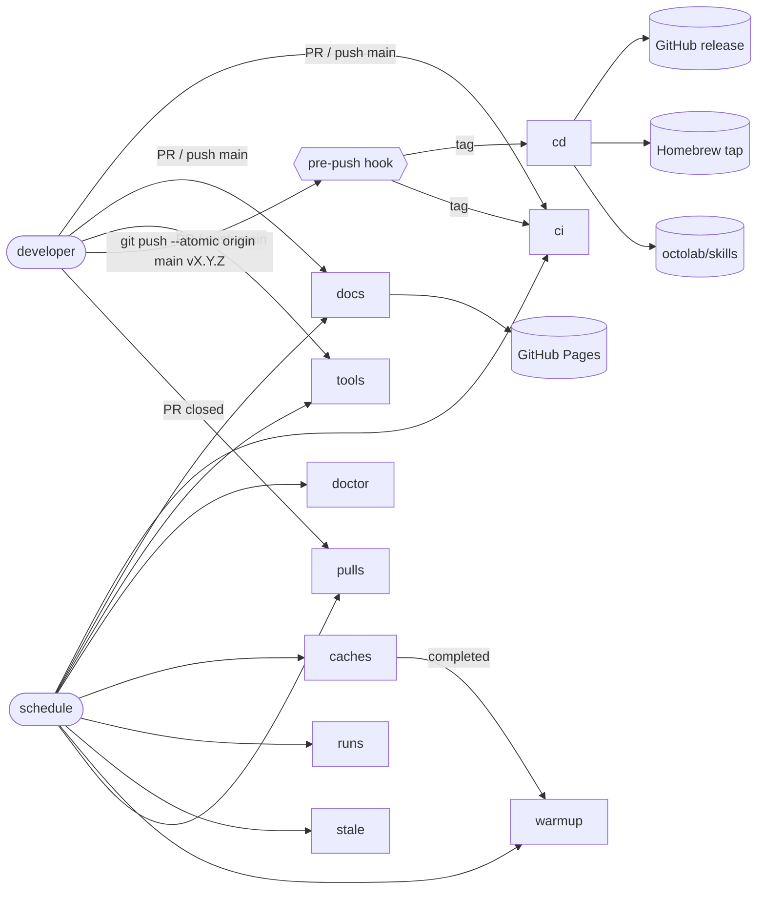
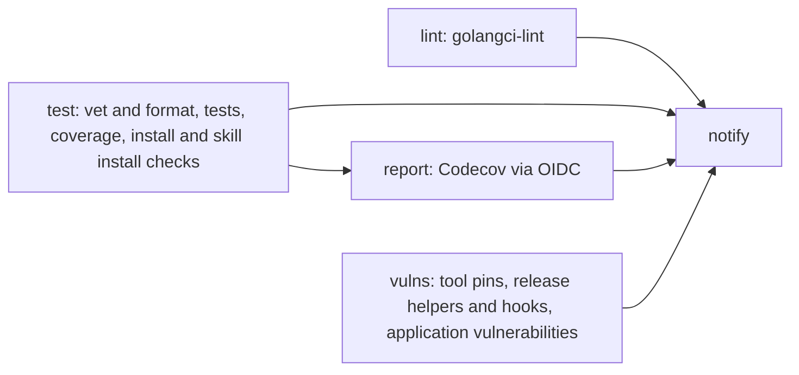
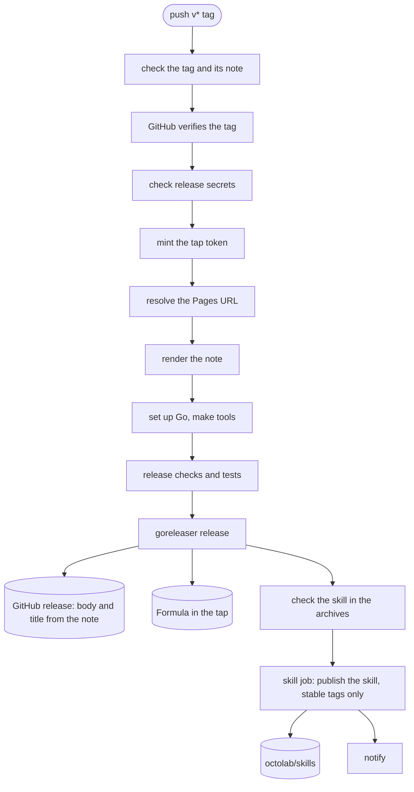
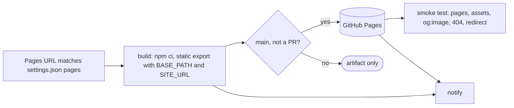
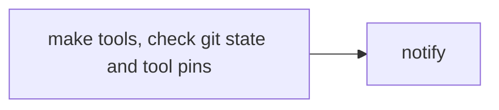
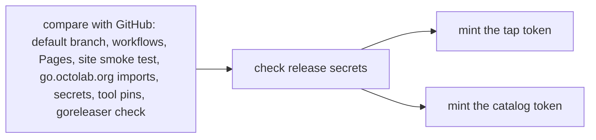
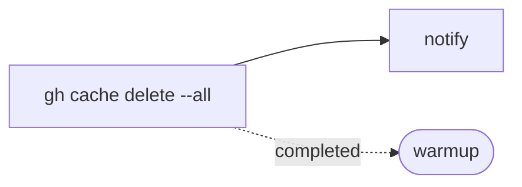
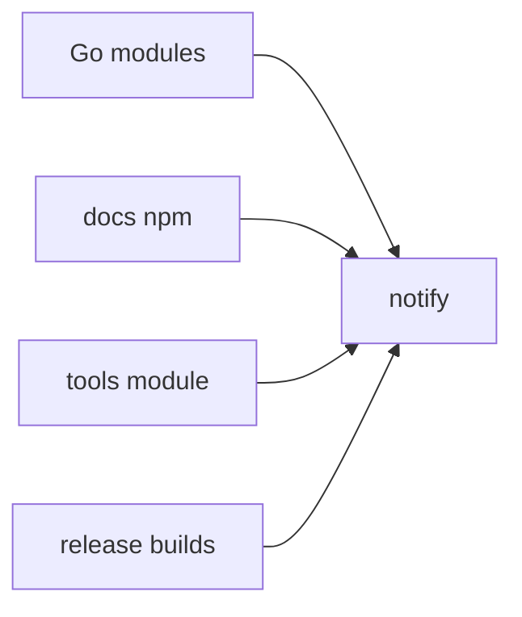
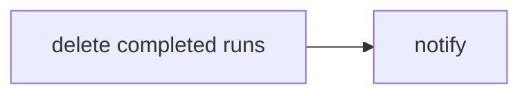
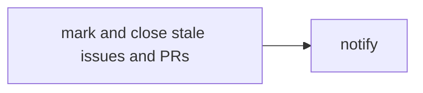

# GitHub Actions

| Workflow | Name | Runs on | Does |
| --- | --- | --- | --- |
| [ci](#ci) | Continuous integration | PR and push to main (Go files, `skills/`, release helpers and hooks), `v*` tag, monthly, manual | Lint, tests, coverage to Codecov, release helpers, vulnerabilities |
| [cd](#cd) | Continuous delivery | `v*` tag, manual | Check the tag, test, publish the release, the Homebrew Formula and the agent skill; a snapshot on manual runs |
| [docs](#docs) | Documentation delivery | PR and push to main (`docs/`), monthly, manual, reusable | Build the site; deploy it to Pages from main |
| [tools](#tools) | Tools validation | PR and push to main (`tools/`), monthly, manual | Install the tools module and check generated code |
| [doctor](#doctor) | Repository doctor | daily, manual | Compare the repository with GitHub and explain fixes |
| [caches](#caches) | Workflow caches cleanup | monthly, manual, reusable | Delete all Actions caches |
| [warmup](#warmup) | Workflow caches warmup | after caches cleanup, push to main (`go.sum`, `tools/go.sum`, `.goreleaser.yml`), twice a week, manual | Refill Go, docs and tools caches; keep the release build cache warm |
| [pulls](#pulls) | Pull request caches cleanup | PR closed, daily, manual | Delete the caches of closed PRs |
| [runs](#runs) | Workflow runs cleanup | monthly on day 2, manual, reusable | Delete completed runs, with a dry run |
| [stale](#stale) | Stale issues cleanup | daily, manual, reusable | Mark and close stale issues and PRs |

Schedules are in UTC: cleanups and the doctor at 06:00, checks at 07:00, monthly on day 1;
runs cleanup on day 2, so the runs of day 1 stay readable until then; the release warmup on Mondays and Thursdays.

## Common ground

- All external actions use concrete release tags. The version history, migration
  notes and verification results are in [the audit report](../reports/20260918T132440Z.md).
  Dependabot checks the `github-actions` ecosystem daily; review upstream changes
  and the action contract before accepting an update.
- GitHub-hosted Ubuntu runners (`ubuntu-24.04`) supply the runtime the actions need.
- Workflow permissions default to `contents: read`; publishing and maintenance
  jobs request more explicitly.
- Every workflow except doctor and pulls ends with a `notify` job that posts to Slack.
  `SLACK_WEBHOOK` is optional: an empty value skips the notification.
- Secrets are checked by `make doctor`, which prints how to create a missing one.

| Secret | Used by | Purpose |
| --- | --- | --- |
| `OCTOLAB_RELEASER_CLIENT_ID` | cd, doctor | Client ID of the GitHub App "OctoLab Releaser" that pushes the Formula to the tap named in `.goreleaser.yml` and the skill to `octolab/skills` |
| `OCTOLAB_RELEASER_KEY` | cd, doctor | Private key of that App |
| `SLACK_WEBHOOK` | all but doctor | Notifications, optional |

## ci

[ci.yml](ci.yml) keeps the main branch green and reports coverage.

- Runs on PRs and pushes to main that touch Go code, `go.mod`, `Makefile`,
  `Taskfile`, the agent skill in `skills/`, the release helpers or hooks, or
  the workflow itself; on `v*` tags; monthly; manually.
- `vulns` runs `node --test .github/scripts/*.test.mjs` first: a broken release
  helper or hook fails on main, not on the tag.
- Codecov uses GitHub OIDC (`id-token: write`). The repository must be activated
  in Codecov; no `CODECOV_TOKEN` is needed.
- PRs get no notification.
- On both Go versions, `test` installs the binary, then installs the agent
  skill with it into an empty temporary home for Claude Code and Codex and
  requires `skill status --exact` to report both copies intact: the maintainer
  installs the skill through the catalog, so this keeps the CLI path checked.
  Makefile builds use the exact tag as their version, or `dev` between tags.
  A branch build must not claim the previous release while embedding a newer skill.

## cd

[cd.yml](cd.yml) publishes a release from a tag.

- **A release is a curated note plus a tag.** Write `docs/content/changelog/<tag>.md`:
  frontmatter `title` and `description`, the first line `# <title>`, Markdown
  and HTML, no MDX, site-relative links. Commit it, tag the commit with a
  signed tag, run `make release-check TAG=<tag>`, then push the branch and the
  tag in one go: `git push --atomic origin main <tag>`.
- **Guardrails come first and fail in seconds.** `make release-check` checks the
  tag against the local branch, before it is pushed, together with the
  `go mod tidy` + `git-check` that `release-verify` would otherwise fail on only
  after the tag is out (ci.yml and tools.yml check it on main too) and
  `goreleaser check`. The `pre-push` hook (`.github/hooks`, wired by
  `make git-hooks`, part of `make setup`) runs `.github/scripts/release.mjs check`
  against the branch of the same push, then the application checks of every
  push, `make go-deps-tidy verify`. The first steps here repeat the tag check
  against `origin` for pushes that bypassed the hook, check that GitHub
  verifies the tag's signature (`release.mjs signature`; the catalog refuses an
  unverified tag, by then too late to replace it), then mint the tap token, all
  before Go is even installed.
- **The note becomes the release.** `release.mjs render` strips the frontmatter
  and the H1, makes site links absolute from the Pages URL and hands the title
  to goreleaser (`release.name_template`).
- **Policy lives in `.github/settings.json`**, documented by `.github/settings.cue`:
  tag pattern, maintenance branches (e.g. `v5.*` tags on branch `v5`), note path.
- The release uses the workflow token. The Formula goes to the tap named in
  `.goreleaser.yml` with a token minted per run by `actions/create-github-app-token`
  from a GitHub App installed on the tap only, with Contents: Read and write.
  goreleaser then omits the committer (`commit_author.use_github_app_token`),
  so GitHub signs the Formula commit as the App; a personal token does not get
  signed commits, see [#108](https://github.com/octopot/indexit/issues/108). install with `brew install --formula octolab/tap/indexit`.
  The Formula installs the CLI, shell completions and the macOS service definition;
  `brew services start octolab/tap/indexit` starts the same binary as the CLI.
  Existing Cask installations require the one-time migration in the
  [local image guide](../../docs/content/guide/local-images.mdx).
  GoReleaser generates and publishes the Formula directly through `brews`;
  no companion package or custom publisher is involved. `skip_upload: auto`
  keeps prereleases out of the stable tap. GoReleaser v2.18.2 supports the
  service block but marks `brews` deprecated. `make release-check` and doctor
  accept only that known deprecation; invalid config and other deprecations fail.
  Revisit the packaging before upgrading to a version that removes `brews`.

- **The agent skill ships with the release.** `skills/indexit/` is embedded in
  the binary and packed into every archive; `release.mjs skill` checks that the
  source, the archives and `indexit skill info` agree on its digest. For a
  stable tag, the `skill` job then runs
  [octomation/skills-action](https://github.com/octomation/skills-action),
  pinned to a release tag: it copies the skill from the tag into the
  catalog, with a commit signed as the App and a tag `indexit--vX.Y.Z`, and
  the digest it published is compared with the source. The catalog token is minted separately, from
  the same App installed on `octolab/skills`: the tap token is scoped to the
  tap. Prerelease tags are not published to the catalog. The job is separate
  so that a failed publication can be rerun alone
  (`gh run rerun <run-id> --failed`) while the release stays as it is; the
  action is idempotent. Dependabot proposes the action's next release with
  its release note; review the note before accepting it.
- A manual run on a branch builds a snapshot and publishes nothing; it still
  checks the skill in the archives.

## docs

[cd.docs.yml](cd.docs.yml) builds the Nextra site and deploys it to GitHub Pages.

- Runs on PRs and pushes to main that touch `docs/`, `.github/settings.json`,
  `release.mjs`, `Taskfile`, `bin/lib/` or the notify action; monthly;
  manually; as a reusable workflow.
- On main, `BASE_PATH` and `SITE_URL` come from the Pages configuration; PR
  previews take them from `.github/settings.json` (`release.mjs site-env`)
  and need no Pages access.
- Pages must use **GitHub Actions** as its source, and the `github-pages`
  environment must allow deployments from main. No `CNAME` file is needed: a
  custom domain is set in Settings → Pages and declared as `pages.cname` in
  `.github/settings.json`; the build stops while they disagree. The domain is
  baked into the build, so rebuild after changing it (see docs/README.md):
  switch Settings → Pages first, then merge the new `pages.cname`; the site
  serves stale asset paths until that deploy finishes. A fork deploying its
  own Pages must drop or change `pages.cname`.
- Independent of releases: merge a note and its new pages before tagging if the
  release must link to them from the first minute.

## tools

[tools.yml](tools.yml) keeps the tools module installable and its generated code in sync.

- Runs on PRs and pushes to main that touch `tools/` or the `Makefile`; monthly; manually.
- The job fails if installing the tools changes tracked files.
- `make tool-pins-check` catches what `make go-tools-update` leaves behind:
  the golangci-lint and goreleaser versions that ci, cd and warmup pass to
  their actions must be the ones `tools/go.mod` requires; the Go versions in
  `tools/go.mod`, the workflows, `GO_VERSIONS` of the `Makefile` and "Go X.Y
  or newer" in the docs must be on the Go line of `go.mod`; the workflows
  must agree on Node.js. It runs here before the scan of the tools, in ci
  `vulns` and in the doctor.

## doctor

[doctor.yml](doctor.yml) runs `release.mjs doctor` and `preflight` in CI; `make doctor` runs the first one locally, and `make workflow-doctor` dispatches the workflow on main and waits for its result.

- Daily and manual: a Pages domain change triggers no workflow, so a site
  built for the old domain is caught here. Each problem is printed with what
  to fix and where.
- Every workflow must be active, except those that `workflows` in
  `.github/settings.json` keeps off on purpose, with the reason the doctor
  prints: `cleanup.stale.yml` for now. Enable a workflow disabled by hand
  after pushing the YAML that should run:
  `gh workflow enable <file> -R octopot/indexit`.
- `go.octolab.org` is in `GOPRIVATE`, so `go` resolves it directly: every
  vanity module in `go.mod` and `tools/go.mod` must answer `?go-get=1` over
  verified HTTPS with a `go-import` tag. A lapsed certificate fails here before
  a fresh runner hits it; `node .github/scripts/release.mjs vanity` checks
  only that.
- The workflow token cannot list secrets, so they show as `unverified` there;
  the preflight step checks the ones a release needs, and minting the tap and
  catalog tokens proves the App is still installed on the tap and on
  `octolab/skills` with write access.
  Locally, `gh` sees the organization secrets shared with the repository.

## caches

[cleanup.caches.yml](cleanup.caches.yml) deletes every Actions cache with the built-in GitHub CLI.

## warmup

[warmup.caches.yml](warmup.caches.yml) refills the caches right after a successful cleanup.

- **The release build cache lives on main.** A tag can restore only caches of
  its own ref and of the default branch, so the cache `cd` restores is made
  here: `goreleaser build` of every target, then the tools and the tests that
  `cd` runs, keyed by the Go version and `go.sum`, `tools/go.sum`,
  `.goreleaser.yml` and the warmup itself. A push to main that changes one of
  them rebuilds it, incrementally from the previous one, a run twice a
  week keeps it inside GitHub's 7-day eviction window, and the other jobs run
  only after a successful cleanup or on demand.
- `cd` builds with full parallelism only on the exact key; any other match
  brings the modules but not a warm build cache, so it keeps `--parallelism 2`
  (a cold cross-compile of gotd takes ~5GB per target on a 16GB runner).

## pulls

[cleanup.pulls.yml](cleanup.pulls.yml) deletes the caches of a pull request once
it is closed: they are scoped to `refs/pull/<n>/merge` and of no use after it,
but count against the 10GB quota. It runs on `pull_request_target`, which keeps
a writable token when Dependabot closes its own PR, and checks out no code.
A run still in progress when its PR closes saves its caches afterwards, so a
daily run sweeps the caches of every PR that is no longer open.
It has no `notify` job, as it runs on every closed PR.

## runs

[cleanup.runs.yml](cleanup.runs.yml) deletes completed workflow runs, without age or count retention.

- To clear the history, run it with `pattern: All` (the default) and `dry_run`
  unchecked. Scheduled and reusable runs also target all workflows, Dependabot
  included. Active runs, including this one, remain.
- The upstream action also deletes orphaned runs of workflows that no longer
  exist, whatever their status or the selected workflow.

## stale

[cleanup.stale.yml](cleanup.stale.yml) marks inactive issues and PRs, then closes them.

- Issues and PRs with an assignee, a milestone or `status: pending` are exempt.
- Disabled by hand for now and declared so in `.github/settings.json`: the open
  issues and PRs to keep need an exemption first, see [doctor](#doctor).
- [.github/integrations/stale/stale.yml](../integrations/stale/stale.yml) keeps
  the settings of the retired Stale app for reference; nothing reads it.
